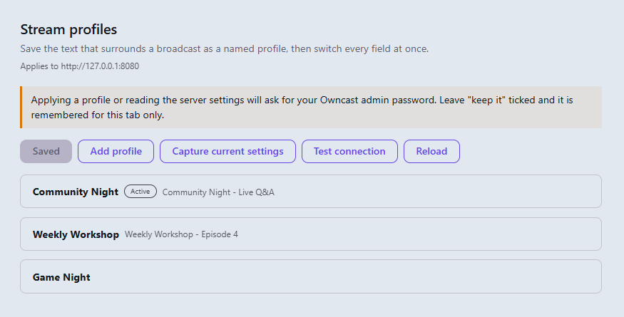

# Stream Profiles

An Owncast plugin that saves the settings describing a broadcast as a named
profile, and switches between them in one click — title, About text, messages,
page content, tags, discovery flags, chat policy and branding.

Requires Owncast `0.3.0` or newer.



The plugin groups its fields into Content, Discoverability, Chat, Advanced and
Branding.

Each profile can also carry its own **viewer access** list — usernames with
passwords, or shared passwords with no username — so switching profile switches
who is allowed to watch. Passwords are stored as a salted hash and only ever
leave the server as a username in the admin page.

Using this makes the plugin the site's login gate, which Owncast allows only one
plugin to be at a time. Browsers see a sign-in page rather than the native HTTP
Basic dialog, because Owncast filters the response header a plugin would need to
prompt one. Players and scripts that send `Authorization: Basic` themselves are
accepted.

## Install

Download `stream-profiles.ocpkg` from the repository's Releases page, then in the
Owncast admin: **Plugins → Upload plugin**, review the permissions, enable it.

Optionally verify the download first — compare it against `SHA256SUMS.txt` from
the same release, or check its signed provenance with the `gh` CLI:

```bash
gh attestation verify stream-profiles.ocpkg \
  --repo FlorianObermayer/owncast-stream-profiles
```

`gh attestation` needs `gh` 2.49 or newer. Debian packages are older than that;
compare the file against `SHA256SUMS.txt` instead, which needs only `sha256sum`.

## Set up

One setting: `owncastUrl` in **Plugins → Stream Profiles → Settings**. Then press
**Capture current settings** on the Profiles tab to import what the server
already uses.

The viewer access list is optional and empty by default, and an empty list on an
**active** profile leaves the site open. With no profile active at all the gate
stays closed, so apply a profile before enabling the plugin — `/admin` stays
reachable either way. See [INSTRUCTIONS.md](INSTRUCTIONS.md) for the full
behaviour.

## Development

Check [CONTRIBUTING.md](CONTRIBUTING.md) for more details on the development workflow.